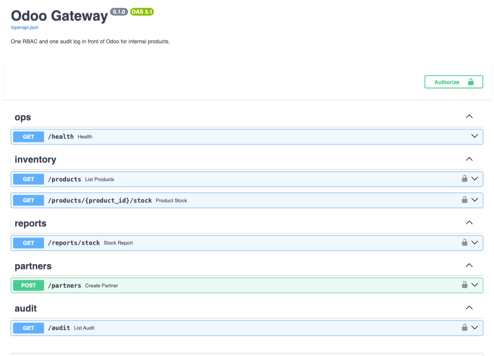

# odoo-gateway

[](https://github.com/sergeonito/odoo-gateway/actions/workflows/ci.yml)
[](pyproject.toml)
[](pyproject.toml)
[](https://github.com/astral-sh/ruff)
[](LICENSE)

A FastAPI service between a company's internal products and Odoo: one role model for every
product, sign-in with Microsoft 365 accounts (Microsoft Entra ID), and an append-only audit
log of who did what.

> **Status:** demo project, in development since October 2026. Runs against Odoo 18 Community
> from the compose stack with a least-privileged integration user; Entra ID is verified with
> locally signed tokens so far (see Roadmap).

## Why a gateway

Internal tools that call Odoo directly each need their own Odoo credentials, repeat their own
access rules, and leave no common trail. The gateway puts three things in one place:

- **Access:** users sign in with their Microsoft 365 account; app roles from Entra ID map to
  internal roles; every route declares the permission it needs.
- **Integration:** one least-privileged Odoo integration user, a typed async client, reads
  retried, writes never retried.
- **Audit:** every write and every refused attempt lands in an append-only table, with the
  caller, the request id and the outcome, but without personal data values.

## What works

| Area | What is there |
| --- | --- |
| Odoo client | Async JSON-RPC (`/jsonrpc`), uid cached, typed errors, Odoo tracebacks never leave the client, backoff with jitter for reads only |
| Auth | Entra ID access tokens (RS256, tenant signing keys, `oid` as subject, app roles mapped by config); HS256 dev tokens, refused when `environment=production` |
| RBAC | Roles `viewer` / `operator` / `admin` → permissions; routes depend on permissions only; every 403 is audited |
| Audit | PostgreSQL table, append-only through triggers (UPDATE, DELETE, TRUNCATE rejected); an `attempted` event before each Odoo write and the outcome after it; field names, not values |
| API | `GET /products` (search by name or internal reference), `GET /products/{id}/stock`, `POST /partners`, `GET /audit`, `GET`/`POST /reconciliation/idempotency`, `GET /health`; OpenAPI at `/docs` |
| Writes | `Idempotency-Key` on `POST /partners`: a retry gets the stored result (`Idempotency-Replayed: true`), the same key with another body is 422, a key still running is 409; keys left behind by a crash are listed and resolved through `/reconciliation/idempotency` (admins, audited) (ADR-0004) |
| Reports | `GET /reports/stock` serves the last stock snapshot from the gateway's database, not Odoo (ADR-0005); a Celery beat + worker pair takes it every `GATEWAY_SNAPSHOT_INTERVAL_S` (Redis broker), `make snapshot` takes one by hand |
| Local Odoo | Compose stack with Odoo 18 (`stock`, `contacts`); `make odoo-setup` creates the integration user with two standard groups and seeds three products with stock; `make odoo-apikey` issues its API key |
| Quality | `mypy --strict`, ruff, pytest (client, auth, API, idempotency, reports, worker), a PostgreSQL trigger test, live smoke tests through the real app against the compose stack, GitHub Actions |

## Not yet

- Entra ID tested with locally signed tokens, not yet with a real tenant.
- No Microsoft Graph sync, rate limiting or Kubernetes manifests.

## Roadmap

1. Microsoft Entra ID with a real tenant: app roles, device-code token, setup guide.
2. Microsoft Graph: group membership sync, disabled users lose access.

## Run it

```bash
make env            # .env with a random dev token secret
make up             # gateway, PostgreSQL, Redis, Celery worker + beat, bundled Odoo 18 (first start ~2 min)
make odoo-setup     # integration user `gateway` + three seed products with stock (as admin, once)
make odoo-apikey    # prints an API key for `gateway`: put it into .env with GATEWAY_ODOO_LOGIN=gateway
make up             # restart the gateway with the integration user

TOKEN=$(make -s token ROLE=viewer)
curl -s -H "Authorization: Bearer $TOKEN" "http://localhost:8000/products?search=DRN"
curl -s -H "Authorization: Bearer $TOKEN" http://localhost:8000/products/<id>/stock
TOKEN=$(make -s token ROLE=operator)
curl -s -X POST -H "Authorization: Bearer $TOKEN" -H "Content-Type: application/json" \
     -H "Idempotency-Key: demo-0001" \
     -d '{"name":"Acme","is_company":true}' http://localhost:8000/partners
# run the same command again: same id, header Idempotency-Replayed: true, no second contact in Odoo
TOKEN=$(make -s token ROLE=admin)
curl -s -H "Authorization: Bearer $TOKEN" "http://localhost:8000/audit?limit=5"
make snapshot       # snapshot now; beat does the same every 15 min (watch: docker compose logs -f worker)
TOKEN=$(make -s token ROLE=viewer)
curl -s -H "Authorization: Bearer $TOKEN" http://localhost:8000/reports/stock
make test-live      # the same path as a test, through the real app and the real audit database
```

Odoo UI: http://localhost:8069 (admin / admin, local only). API docs: http://localhost:8000/docs



A recorded walk through the same commands, 80 seconds: reads, a refused write and its audit
event, `Idempotency-Key` replay, the audit pair, Odoo down:
[asciinema.org/a/KgrmdI53dmsI5c9X](https://asciinema.org/a/KgrmdI53dmsI5c9X).

### Use your own Odoo

The gateway only needs the standard `product`, `stock` and `contacts` models and an integration
user, so it can sit in front of any Odoo 18 (the snapshot filters on `is_storable`, an
Odoo 18 field). In `.env`:

```bash
COMPOSE_PROFILES=                                   # do not start the bundled Odoo
GATEWAY_ODOO_URL=https://odoo.example.com           # as seen from your machine (make token, make test-live)
GATEWAY_ODOO_URL_IN_DOCKER=https://odoo.example.com # as seen from the gateway container
GATEWAY_ODOO_DB=production
GATEWAY_ODOO_LOGIN=gateway
GATEWAY_ODOO_API_KEY=...                            # Settings → Users → gateway → API Keys
```

Create the integration user in that Odoo with the groups *Inventory / User*
(`stock.group_stock_user`) and *Contact Creation* (`base.group_partner_manager`), no password,
and issue it an API key. `make odoo-setup` is written for the bundled instance: it also seeds
demo products, so do not run it against a real database. For an Odoo running on the host
machine use `http://host.docker.internal:8069` as the in-Docker URL.

## Findings from the live run

What the mocked tests could not tell, and what changed because of it:

- **API keys cannot be issued over RPC.** `res.users.apikeys._generate` is private, so
  `make odoo-apikey` runs it inside `odoo shell`. The integration user has no password at all:
  it cannot sign in to the UI, only present its key.
- **Standard groups over-grant.** Inventory / User (`stock.group_stock_user`) is the smallest
  standard group that can read `stock.quant`, but it also allows writing quants. A custom group
  with read-only access would be tighter; for a demo the standard groups and ADR-0002 are the
  honest trade-off.
- **Inventory adjustments over RPC** need `context={"inventory_mode": true}` on
  `stock.quant.create` plus a call to `action_apply_inventory`. Odoo 18 products use
  `type="consu"` with `is_storable=true`; `detailed_type` is gone.
- **Search by name only was not enough.** The seed products are found by internal reference
  (`DRN-…`), so `GET /products?search=` now matches `default_code` too.
- **Odoo installs demo data** unless `--without-demo` is passed, so a fresh stack already has
  39 products. The seed adds three with known quantities that the live tests assert on.
- **`docker compose exec odoo odoo …` bypasses the image entrypoint**, so database flags must be
  passed explicitly (see the `odoo-apikey` target).

## Develop

```bash
uv sync
make check        # ruff + mypy --strict + pytest
make test-live    # against the running compose stack
make migration MSG="add x"   # autogenerated from the models and formatted by ruff; review it
```

Migrations are generated from the SQLAlchemy models and reviewed by hand: autogenerate does
not see triggers, renames or data moves, so those parts are written explicitly (as the
append-only triggers in migration 0001 are).

## Architecture and design decisions

[docs/architecture.md](docs/architecture.md): one request end to end, layers and dependency
rules, where each decision is made, what the audit log holds, failure behaviour.

- [ADR-0001](docs/adr/0001-gateway-in-front-of-odoo.md): a gateway instead of direct Odoo access
- [ADR-0002](docs/adr/0002-roles-in-gateway-one-odoo-user.md): roles live in the gateway; Odoo sees one integration user
- [ADR-0003](docs/adr/0003-json-rpc-now-json2-later.md): JSON-RPC now, JSON-2 when Odoo moves to 19+
- [ADR-0004](docs/adr/0004-audit-after-the-call.md): a write touches two systems; `attempted` events and `Idempotency-Key` close the gap
- [ADR-0005](docs/adr/0005-stock-report-from-snapshot.md): the stock report reads a periodic snapshot, not Odoo

## Layout

```
src/odoo_gateway/
  api/           routes, dependencies (auth, permissions), request/response models
  auth/          roles and permissions, token verification (dev, Entra ID)
  audit/         audit table and log
  idempotency/   idempotency_keys table and the claim / complete / release store (ADR-0004)
  reports/       stock snapshot tables, the snapshot/report use case, the snapshot job (ADR-0005)
  worker.py      Celery app: beat schedule and the snapshot task, a thin call into reports/jobs.py
  db.py          declarative base shared by the gateway's own tables
  odoo/          JSON-RPC client and error mapping
  ports.py       what routes need from Odoo (the client is one implementation)
  main.py        app factory, request ids, error mapping
migrations/      Alembic: 0001 audit table + append-only triggers, 0002 stock snapshots,
                 0003 `attempted` outcome, 0004 idempotency keys
scripts/         setup_odoo.py (integration user + seed), odoo_apikey.py (runs inside odoo shell)
tests/           unit and API tests; PostgreSQL and live Odoo tests skip unless enabled
```
