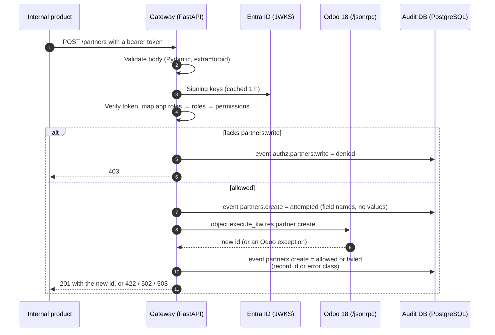
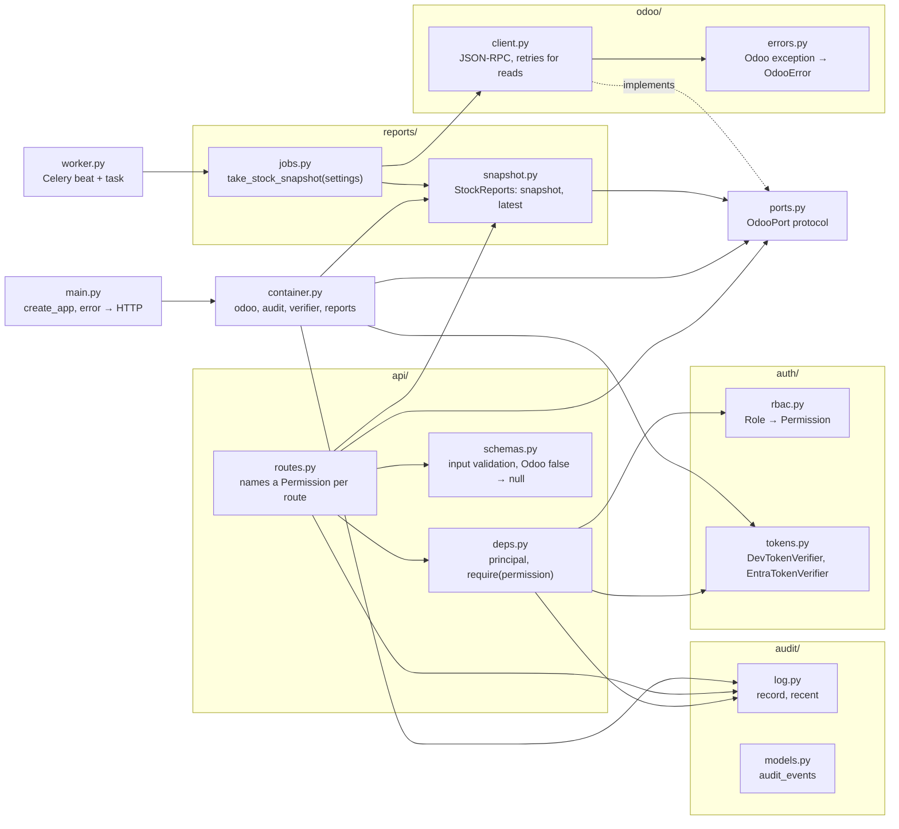
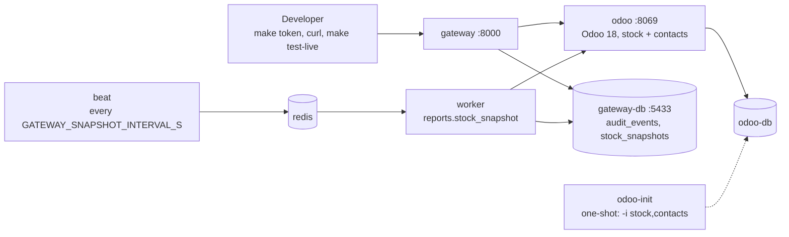

# Architecture

The gateway is one HTTP service that internal products call instead of Odoo. It answers three
questions in one place: who is calling, what they may do, and what they did.

## One request, end to end

Reads (`GET /products`, `GET /products/{id}/stock`) follow the same path without the audit
event on success: refusals are always audited, successful reads are not.

## Layers

Dependency rules, enforced by imports and by tests:

- `api/` depends on `OdooPort`, never on `odoo/client.py`. The API tests run against `FakeOdoo`
  (`tests/conftest.py`), which is why they need no Odoo.
- `odoo/` is the only package that knows JSON-RPC. Replacing the transport (Odoo 19 JSON-2,
  [ADR-0003](adr/0003-json-rpc-now-json2-later.md)) means a second `OdooPort` implementation.
- `auth/rbac.py` is the single source of roles → permissions. Routes name a `Permission`;
  nothing outside `rbac.py` mentions a `Role`.
- `main.py` wires the real implementations into a `Container` in the lifespan; tests pass their
  own `Container` to `create_app`.

## Where decisions are made

| Question | Where | Notes |
| --- | --- | --- |
| Is the token genuine? | `auth/tokens.py` | Dev: HS256 with the gateway's secret, refused in production. Entra: RS256 against the tenant's JWKS, issuer and audience pinned. |
| Who is this? | `auth/tokens.py` | Entra `oid` (stable across apps), not `sub`. |
| What may they do? | `auth/rbac.py` | App roles → internal roles by configuration; roles → permissions in code. Unknown roles grant nothing. |
| May this route run? | `api/deps.py` | `require(permission)`; every refusal is audited before the 403. |
| Is the input sane? | `api/schemas.py` | Lengths, patterns, `extra="forbid"`. A 422 here never reaches Odoo. |
| How does Odoo see us? | `odoo/client.py` | One integration user with an API key and two standard groups ([ADR-0002](adr/0002-roles-in-gateway-one-odoo-user.md)). |
| What happens on failure? | `main.py` | `OdooValidationError` → 422 with Odoo's user-facing message; `OdooUnavailableError` → 503; auth/access errors of the integration user → 502 "Upstream error", details in logs only. |

## What the audit log holds

Two rows per write (`attempted` before the Odoo call, the outcome after it) and one per refusal
in `audit_events`:

| Column | Example | Why |
| --- | --- | --- |
| `actor_subject`, `actor_name`, `actor_roles` | `oid`, "Olena K.", `["operator"]` | Who, as the identity provider knows them |
| `action`, `outcome` | `partners.create`, `attempted` / `allowed` / `denied` / `failed` | What was attempted and how it ended |
| `resource_model`, `resource_id` | `res.partner`, 44 | Which Odoo record |
| `request_id` | from `X-Request-ID` or generated | Correlates with application logs |
| `details` | `{"fields": ["email", "name"]}` or `{"error": "OdooValidationError"}` | Field names and error classes only, never submitted values |

The table is append-only at the database level: triggers reject `UPDATE`, `DELETE` and
`TRUNCATE` (migration 0001, tested against PostgreSQL in CI). A crash between the Odoo commit
and the outcome event leaves an `attempted` row with no `allowed` or `failed` after it, which is
what a reconciliation looks for ([ADR-0004](adr/0004-audit-after-the-call.md)).

## Failure behaviour

| Failure | Gateway does | Caller sees |
| --- | --- | --- |
| Odoo unreachable or HTTP 5xx | Retries reads with exponential backoff and jitter (2 retries by default); never retries writes | 503 |
| Odoo rejects the integration user's key | Drops the cached uid, re-authenticates on the next call | 502 |
| Integration user lacks a group | Logs the Odoo exception name | 502, no details |
| Odoo `ValidationError` / `UserError` | Audits `failed` with the error class | 422 with Odoo's message |
| Audit insert fails | Propagates: a write that cannot be audited is not reported as success | 500 |

## Local stack

The worker and beat run from the gateway image. Beat only enqueues; the worker reads Odoo with
the same integration user and writes the snapshot the API serves from `GET /reports/stock`.

`make odoo-setup` creates the integration user and seed products through the gateway's own
client; `make odoo-apikey` issues its API key inside `odoo shell`, the one step Odoo does not
expose over RPC.
